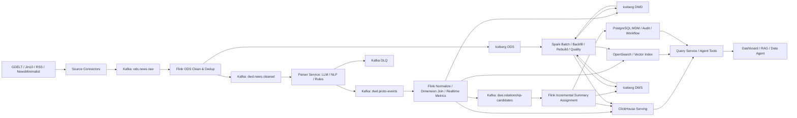

# Event Timeline Engine 数据管理升级计划

## 1. 结论先行

项目升级后的职责边界建议如下：

- **Spark**：离线批处理、历史回填、全量重建、Embedding 批计算、关系候选批计算和大规模质量审计。
- **Flink**：实时采集后的清洗、去重、事件时间处理、状态流转、维表关联、实时指标和增量关系候选计算。
- **Kafka**：解耦采集、解析、标准化、图谱和 Serving，同步保存可重放的事件日志。
- **Iceberg + 对象存储**：承载 ODS/DWD/DWS 历史明细，支持 ACID、Schema Evolution、Time Travel 和批流统一读取。
- **ClickHouse**：承载 Dashboard、时间线、趋势和聚合类实时 OLAP 查询。
- **OpenSearch**：承载新闻全文检索、事件关键词检索和混合召回。
- **PostgreSQL**：保留业务配置、审核工作流、实体主数据、任务控制和强事务接口，不再承担全部分析计算。
- **向量库**：初期使用 OpenSearch Vector 或 PostgreSQL `pgvector`，数据量增长后再评估 Milvus。

需要明确：**Flink 是实时流计算引擎，不是面向 Dashboard 或 Agent 的主要在线查询数据库**。Flink 计算实时结果并写入 Serving Store，API 再查询 ClickHouse、OpenSearch、PostgreSQL 或向量索引。

## 2. 升级目标

### 2.1 业务目标

1. 新新闻进入系统后，分钟级完成原子事件抽取、标准化和可查询化。
2. 支持新闻、事件、实体、主题和关系的统一检索与记录级血缘追溯。
3. 支持算法升级后的全量重算，不阻塞在线写入和查询。
4. 为 Data Agent 提供稳定、可审计、低延迟的数据工具层。
5. 建立统一指标口径、数据质量规则和版本治理机制。

### 2.2 非功能目标

| 指标 | 第一阶段目标 | 成熟阶段目标 |
| --- | --- | --- |
| 实时链路端到端延迟 | P95 小于 5 分钟 | P95 小于 60 秒（不含外部 LLM 排队） |
| Dashboard 聚合查询 | P95 小于 2 秒 | P95 小于 500 毫秒 |
| 单条事件检索 | P95 小于 500 毫秒 | P95 小于 200 毫秒 |
| 流任务恢复 | 30 分钟内 | 5 分钟内，状态不丢失 |
| 核心表数据完整率 | 大于 99% | 大于 99.9% |
| 重复新闻率 | 小于 1% | 小于 0.1% |
| 血缘覆盖率 | 核心链路 100% | 字段级核心链路 100% |

这些目标是规划值，必须通过压测和线上基线校准，不能直接当成现有项目成果。

## 3. 目标架构



### 3.1 控制面与数据面

- **数据面**：Kafka、Flink、Spark、Iceberg、ClickHouse、OpenSearch，负责数据流动、计算和查询。
- **控制面**：PostgreSQL 保存实体标准、动作标准、质量规则、任务版本、审核结论和发布状态。
- **应用面**：现有 Express API 逐步改造成 Query Service 和 Agent Tool Gateway。

## 4. 数仓分层设计

### 4.1 ODS：原始数据层

建议表：

- `ods_news_raw`：原始新闻正文、标题、来源 URL、发布时间、抓取时间和原始 Payload。
- `ods_source_fetch_log`：抓取批次、游标、HTTP 状态、成功数、失败数和耗时。
- `ods_parser_raw_response`：模型、Prompt 版本、原始响应、Token、耗时和错误。

设计规则：

- 原始数据原则上只追加，不直接覆盖。
- 使用 `source + source_url` 或来源原生 ID 生成业务键。
- 同时保存 `event_time`、`ingestion_time` 和 `processing_time`。
- 敏感字段、正文保存周期和归档规则独立配置。

### 4.2 DWD：明细事实层

建议事实表：

- `dwd_news_cleaned`：清洗、去重后的新闻事实。
- `dwd_proto_event`：一篇新闻中的一个原子事件事实。
- `dwd_event_entity_relation`：事件与主体、客体、地点等实体关系。
- `dwd_llm_parse_result`：解析过程、版本、状态和质量信息。

建议维度表：

- `dim_source`、`dim_entity`、`dim_action`、`dim_event_type`、`dim_location`、`dim_date`。
- 实体、动作标准化采用 SCD Type 2 或显式 `valid_from/valid_to/version`，确保历史口径可追溯。

核心粒度：

- `dwd_news_cleaned`：一条唯一新闻。
- `dwd_proto_event`：一条新闻中的一个原子事实。
- `dwd_event_entity_relation`：一个事件与一个实体在一种角色上的关联。

### 4.3 DWS：主题汇总层

建议表：

- `dws_relationship_summary`：主题/关系簇及生命周期。
- `dws_summary_member`：原子事件与 Summary 的多对多归属。
- `dws_atomic_relationship`：事件到事件的有向关系。
- `dws_entity_event_1d`：实体每日事件统计。
- `dws_source_quality_1d`：来源每日质量统计。
- `dws_topic_trend_1h`：主题小时级趋势和异动指标。

### 4.4 ADS：应用服务层

建议数据集：

- `ads_dashboard_overview_rt`：实时总览指标。
- `ads_topic_timeline_rt`：主题时间线。
- `ads_entity_risk_trend_rt`：实体趋势与异动。
- `ads_relationship_graph_snapshot`：图谱查询快照。
- `ads_agent_event_context`：供 RAG/Agent 使用的事件上下文宽表。
- `ads_data_quality_dashboard`：延迟、完整率、重复率、失败率和审核率。

ADS 不建议只存在为数据库视图。高频复杂查询应由 Flink/Spark 预计算后写入 ClickHouse 或 OpenSearch。

## 5. 实时链路：Flink 设计

### 5.1 Flink 负责的任务

1. 统一字段、时间格式和语言标记。
2. 基于业务键和内容指纹进行有状态去重。
3. 使用 Event Time 和 Watermark 处理迟到新闻。
4. 关联实体、动作和来源维表。
5. 计算小时级主题趋势、来源质量和解析状态指标。
6. 将 proto 事件分配到候选 Summary，并输出增量关系候选。
7. 将合法数据写入 Iceberg/ClickHouse/OpenSearch，将异常数据写入 DLQ。

### 5.2 LLM 调用边界

不要在 Flink Operator 中直接进行长耗时、不稳定的同步 LLM 调用。推荐：

```text
Flink/Kafka -> Parser Request Topic
Parser Service Consumer -> LLM/NLP/Rules
Parser Service -> Parser Result Topic
Flink -> 校验、维表关联、入 DWD
```

原因：LLM 延迟高、限流明显、可能重试，直接放入 Flink 算子会造成反压、Checkpoint 超时和状态膨胀。Parser Service 应支持幂等请求、限流、批量调用、模型降级和结果缓存。

### 5.3 Exactly-once 与幂等

- Kafka Source 使用稳定 `event_id`。
- Flink 开启 Checkpoint，生产环境配置外部化 Checkpoint 和 Savepoint。
- Iceberg Sink 使用 Flink 两阶段提交能力。
- ClickHouse/OpenSearch Sink 使用确定性文档 ID 或业务主键实现幂等 Upsert。
- Parser Service 以 `news_id + parser_version + prompt_version` 作为请求幂等键。
- 对外不能承诺全链路天然 Exactly-once；外部 LLM 调用通过幂等键和结果缓存实现 Effectively-once。

### 5.4 迟到与乱序

- `published_at` 作为业务事件时间，`fetched_at` 作为摄入时间。
- 按来源设置 Watermark，例如高频源 5 分钟、RSS 30 分钟、历史 GDELT 回补 24 小时。
- 超过 Watermark 的严重迟到数据进入 side output，再由 Spark 日批修正 DWS/ADS。

## 6. 离线链路：Spark 设计

### 6.1 Spark 负责的任务

1. 全量和增量历史回填。
2. Parser、Prompt、实体规则升级后的版本化重算。
3. 大规模内容指纹与近重复聚类。
4. Embedding 批生成和向量索引重建。
5. Summary 全量归属、合并评估和图关系批计算。
6. 数据质量日检、跨层对账和异常修复建议。
7. ClickHouse/OpenSearch Serving 数据重建。

### 6.2 替换现有 Node 脚本

| 现有实现 | 目标实现 |
| --- | --- |
| `rebuild-atomic-relationship-graph.mjs` | Spark Summary/Relationship Rebuild Job |
| `backfill-unassigned-atomic-graph.mjs` | Spark Incremental Backfill Job |
| `audit-news-dedup.mjs` | Spark Dedup Quality Job |
| `audit-normalizations.mjs` | Spark Standardization Audit Job |
| `check-consistency.mjs` | Spark Cross-layer Reconciliation Job |
| PostgreSQL Job Queue | Kafka Topic + Flink State；控制任务保留 PostgreSQL |

Node 脚本先保留为对照实现和小规模运维工具，结果校验一致后再下线，避免 Big Bang 迁移。

## 7. 查询与 Serving 设计

### 7.1 查询路由

| 查询类型 | 推荐引擎 | 示例 |
| --- | --- | --- |
| 强事务与审核 | PostgreSQL | 实体标准发布、人工审核、任务控制 |
| 实时聚合与趋势 | ClickHouse | 小时趋势、Top-N、Dashboard 总览 |
| 全文与条件检索 | OpenSearch | 新闻搜索、事件关键词、过滤检索 |
| 向量相似检索 | OpenSearch Vector/pgvector | RAG 语义召回 |
| 历史大范围分析 | Spark SQL/Trino | 年度统计、全库质量审计 |
| 图多跳查询 | 初期 ClickHouse/PostgreSQL；复杂后评估图数据库 | 事件路径、共同实体、主题桥接 |

### 7.2 API 改造

现有 Express API 增加 Query Router：

- `SearchRepository` 查询 OpenSearch。
- `AnalyticsRepository` 查询 ClickHouse。
- `GovernanceRepository` 查询 PostgreSQL。
- `LakehouseRepository` 仅用于管理型历史查询，不直接承接高并发接口。
- API 返回统一的 `data_version`、`generated_at`、`source_ids` 和 `lineage_id`。

## 8. 数据治理设计

### 8.1 元数据与血缘

- 使用 OpenLineage 采集 Spark/Flink 任务输入输出。
- 使用 DataHub 或 OpenMetadata 管理表、字段、Owner、口径和血缘。
- 每条核心事实保存 `source_record_id`、`pipeline_run_id`、`parser_version`、`prompt_version`、`normalization_version`。
- 指标必须登记中文名、英文名、业务定义、SQL 口径、维度、刷新频率和负责人。

### 8.2 数据质量规则

| 层级 | 规则 |
| --- | --- |
| ODS | 来源唯一键非空、原文可解析、发布时间合法、抓取批次完整 |
| DWD | 主体/动作必填、置信度范围合法、新闻外键存在、重复率受控 |
| DWS | Summary 必须有成员、关系边两端存在、禁止自环、时间范围一致 |
| ADS | 与 DWS 对账、刷新延迟达标、Top-N 无异常突变、接口结果非空 |

质量结果写入统一表并触发告警，严重错误阻断数据发布，低置信度语义问题进入人工审核。

### 8.3 版本与发布

- 数据表增加 `schema_version` 和 `logic_version`。
- Parser、Prompt、归一化规则和关系算法独立版本化。
- 新版本先 Shadow Run，与旧版本按数量、字段差异、质量指标和人工样本对比。
- 通过质量门禁后切换 Serving 视图或别名，失败可回滚到旧 Snapshot。

## 9. 分阶段迁移计划

### Phase 0：基线与契约治理（1-2 周）

目标：先把当前系统说清楚，不引入分布式组件。

- 固化 `news`、`proto_events`、summary 和关系边的数据字典。
- 为核心消息定义 JSON Schema/Avro Schema 和兼容规则。
- 增加 `pipeline_run_id`、`parser_version`、`prompt_version`。
- 采集当前吞吐、延迟、失败率、重复率和查询耗时基线。
- 建立 100-500 条 Golden Set。

验收：核心表粒度、主键、Owner、质量规则和链路图完整；现有指标有基线数据。

### Phase 1：Kafka 解耦与双写（2-4 周）

目标：将采集、解析和图计算从进程内调用改为事件驱动。

- 部署 Kafka 和 Schema Registry。
- Source Connector 写 `ods.news.raw`，同时保留 PostgreSQL 原链路。
- Parser Service 消费请求 Topic，输出结构化结果和 DLQ。
- 使用 Outbox 或 CDC 防止数据库写入与 Kafka 发布不一致。
- 建立 Lag、吞吐、失败和 DLQ 监控。

验收：双写数据量、主键和关键字段一致率达到 99.9%；Topic 可按时间完整回放。

### Phase 2：Lakehouse + Spark 离线链路（3-5 周）

目标：将历史数据、全量重算和质量审计迁出 PostgreSQL。

- 部署对象存储和 Iceberg Catalog。
- 建立 ODS/DWD/DWS Iceberg 表。
- 使用 Spark 导入历史 PostgreSQL 数据。
- 实现去重、回填、Summary 重建和跨层对账 Job。
- 通过 Airflow/Dagster 调度 Spark 任务。

验收：同一历史范围下，新旧链路数量与核心字段一致；重算可从指定 Snapshot 重复执行。

### Phase 3：Flink 实时链路（4-6 周）

目标：替换 Node 定时 Sweep 后的同步加工和数据库 Worker。

- 实现实时清洗去重、Watermark、维表关联和质量分流。
- 实现 parser result 到 DWD 的持续加工。
- 实现实时 Summary 候选分配和小时级指标。
- 配置 Checkpoint、Savepoint、状态后端和故障恢复演练。

验收：实时结果与 Spark 日批对账；故障恢复后无不可解释丢数或重复；延迟达到阶段目标。

### Phase 4：Serving 分离（2-4 周）

目标：PostgreSQL 从全能数据库收缩为事务与治理库。

- 聚合查询迁移 ClickHouse。
- 全文和向量检索迁移 OpenSearch。
- API 增加 Query Router、缓存和熔断。
- 用影子流量比较新旧查询结果和延迟。

验收：核心接口结果一致；查询 P95 达标；PostgreSQL 分析型 CPU 与慢查询显著下降。

### Phase 5：Data Agent 与治理闭环（3-5 周）

目标：将数据平台能力正式暴露为可信 Agent Tools。

- 建设指标语义层和业务术语库。
- 提供 `search_news`、`query_metric`、`trace_lineage`、`query_graph`、`generate_report` Tools。
- SQL Tool 增加只读账号、AST 校验、成本门控和行数限制。
- 建立 Agent Eval：Tool 成功率、SQL 正确率、引用覆盖率、答案忠实度和人工采纳率。

验收：关键场景形成固定评测集；Agent 回答包含来源与数据版本；高风险操作全部被审计。

## 10. 技术选型原则

不要为了简历一次性上齐所有组件。按数据规模选择：

### 小规模开发版

- Redpanda/Kafka 单节点。
- MinIO + Iceberg REST Catalog。
- Spark Local/Standalone。
- Flink Standalone。
- PostgreSQL + pgvector。
- 继续使用现有 Express API。

### 中大型生产版

- Kafka 多副本 + Schema Registry。
- S3/HDFS + Iceberg + 独立 Catalog。
- Spark on Kubernetes/YARN。
- Flink on Kubernetes，独立 JobManager/TaskManager。
- ClickHouse 集群 + OpenSearch 集群。
- Airflow/Dagster、Prometheus/Grafana、DataHub/OpenMetadata。

只有在当前 PostgreSQL 出现容量、并发、重算或隔离瓶颈后，才引入对应组件。技术选型要由 SLA 和数据规模驱动，不由岗位关键词驱动。

## 11. 主要风险与控制

| 风险 | 控制措施 |
| --- | --- |
| 组件过多导致运维复杂 | 分阶段引入；开发环境单节点；统一容器化和监控 |
| 批流结果口径不一致 | 共享 Schema、公共 UDF、版本号和每日对账 |
| LLM 调用拖垮流任务 | 独立 Parser Service、异步 Topic、限流和缓存 |
| 双写不一致 | Outbox/CDC、幂等键、补偿任务和对账 |
| 维表变更影响历史结果 | SCD2、规则版本、Time Travel 和 Shadow Run |
| Serving 数据陈旧 | Freshness 指标、延迟告警、数据版本返回 |
| 大规模图关系再次爆炸 | Summary 候选限制、时间窗口、Top-K、边类型分级和离线重算 |

## 12. 面试表达版本

可以这样描述升级思路：

> 当前项目使用 PostgreSQL 和 Node Worker 已经跑通了多源采集、原子事件抽取、关系图谱和回填闭环。下一阶段我不会简单地说“用 Flink 做实时查询”，而是把系统拆成计算层和 Serving 层：Kafka 负责可重放事件总线，Flink 负责实时清洗、去重、事件时间和增量聚合，Spark 负责历史回填、全量重算和大规模关系计算，Iceberg 统一保存 ODS/DWD/DWS，ClickHouse 和 OpenSearch 分别承担实时分析与检索，PostgreSQL 收缩为主数据、审核和事务控制库。迁移采用 Kafka 双写、Shadow Run、批流对账和 Serving 灰度切换，避免一次性重构导致数据不可验证。

