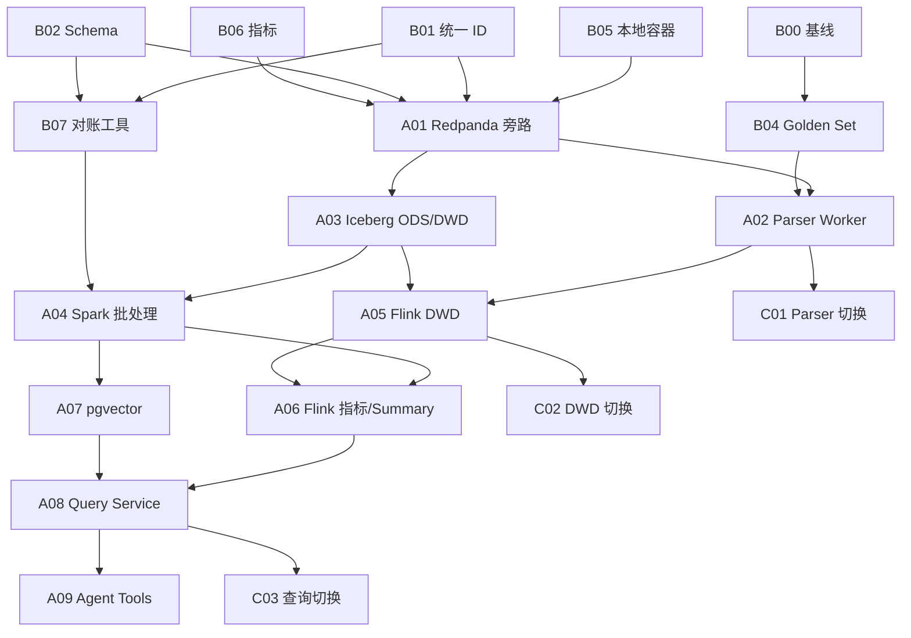

# 小规模数据平台升级执行计划

## 1. 目标与边界

本计划用于单机或小型开发环境，在不推翻现有 Node.js + PostgreSQL 系统的前提下，逐步引入：

- Redpanda 单节点，提供 Kafka 兼容消息总线。
- MinIO + Iceberg REST Catalog，提供本地 Lakehouse。
- Spark Local，处理离线回填、重算和质量审计。
- Flink Standalone，处理实时清洗、去重和增量聚合。
- PostgreSQL + pgvector，继续承担事务、治理和初期向量检索。
- 现有 Express API，作为统一查询和 Agent Tool 接口。

升级原则：

1. **先契约后组件**：先确定主键、Schema、版本和口径，再接 Kafka/Spark/Flink。
2. **先旁路后切换**：新链路先 Shadow Run，不直接替换当前生产路径。
3. **每项可独立验收**：每个基础任务必须能单独提交、测试和回滚。
4. **批流共用口径**：Spark 与 Flink 使用同一数据契约、主键规则和质量规则。
5. **保留现有链路**：完成结果对账之前，Node Worker 和 PostgreSQL 表仍是权威路径。

## 2. 推荐目录结构

```text
eventTimeLine/
├── contracts/                    # JSON Schema、Topic 和表契约
├── infra/dev/                    # Docker Compose 与初始化脚本
├── services/parser-worker/       # 独立 Parser Consumer
├── jobs/spark/                   # PySpark 离线任务
├── jobs/flink/                   # PyFlink/Flink SQL 实时任务
├── lakehouse/ddl/                # Iceberg DDL
├── quality/                      # 质量规则、Golden Set、对账查询
├── observability/                # 指标和 Dashboard 配置
└── docs/runbooks/                # 启停、恢复、回滚手册
```

建议小规模版优先使用 Python：PySpark、PyFlink/Flink SQL 与现有 Python NLP 服务共享开发语言；Node.js 保留在采集、API 和现有 Parser 编排层。

## 3. 任务分层规则

- **基础任务 B**：修改范围小、依赖少，可以并行实施；目标是建立迁移所需的契约、测试和运行底座。
- **高级任务 A**：涉及跨组件数据流、状态、容错或切换；必须依赖一个或多个基础任务。
- **切换任务 C**：改变系统权威数据源或在线流量；只有高级任务对账通过后才能执行。

## 4. 基础任务

### B00：建立迁移基线

**目的**：为所有后续任务提供可比较的旧链路结果。

**工作内容**：

- 记录 `news`、`proto_events`、summary members、relationship edges 的数据量。
- 记录采集、解析、构边和常用 API 的 P50/P95 耗时。
- 固化 100-500 条代表性新闻样本。
- 导出一份新闻到 proto、summary 和 edge 的完整结果快照。

**产出**：

- `quality/baseline/metrics.json`
- `quality/fixtures/news-sample.jsonl`
- `quality/baseline/expected-results.jsonl`

**验收**：同一数据库快照重复执行基线脚本，核心数量和主键集合一致。

**依赖**：无。

### B01：定义统一事件标识

**目的**：消除 PostgreSQL 自增 ID 无法跨 Kafka、Iceberg、Spark 和 Flink稳定关联的问题。

**工作内容**：

- `news_id`：优先来源原生 ID；否则使用 `SHA-256(source + normalized_url)`。
- `proto_event_id`：使用 `SHA-256(news_id + parser_version + event_index + canonical_payload)`。
- `relationship_id`：使用 `SHA-256(source_proto_id + target_proto_id + relation_type + logic_version)`。
- 保留旧整数 ID 作为 `legacy_id`，迁移期双 ID 并存。

**产出**：标识规范、Node/Python 两套一致性实现和跨语言测试向量。

**验收**：Node 与 Python 对 1000 组输入生成完全一致的 ID；字段顺序变化不会影响 canonical payload。

**依赖**：无。

### B02：定义消息与表 Schema

**目的**：建立批流共用的数据契约。

**工作内容**：

- 定义 `NewsRaw`、`NewsCleaned`、`ParserRequest`、`ParserResult`、`ProtoEvent`、`RelationshipCandidate`、`DeadLetter`。
- 每个 Schema 包含 `schema_version`、`event_id`、`event_time`、`ingested_at`、`pipeline_run_id`。
- 定义必填字段、枚举、默认值和向后兼容规则。
- 第一阶段使用 JSON Schema；稳定后再评估 Avro/Protobuf 和 Schema Registry。

**产出**：`contracts/schemas/*.schema.json`、样例消息和 Schema 校验器。

**验收**：合法样例全部通过；缺失主键、非法时间和非法置信度必须失败；旧版本消息可按兼容规则读取。

**依赖**：无，可与 B01 并行；最终需引用 B01 的主键规范。

### B03：补齐处理版本与运行标识

**目的**：让同一新闻在不同算法版本下可重算、可对比、可回滚。

**工作内容**：

- PostgreSQL 核心表补充 `pipeline_run_id`、`schema_version`、`parser_version`、`prompt_version`、`normalization_version`、`logic_version`。
- 所有版本字段写入 API 响应和解析日志。
- 旧数据迁移为明确的 `legacy-v1`，不留隐式 NULL。

**产出**：SQL Migration、写入逻辑和版本约定。

**验收**：新增数据版本字段完整率 100%；旧数据可区分；迁移可回滚。

**依赖**：无。

### B04：建设 Golden Set 与质量规则

**目的**：让新旧链路比较从“看起来差不多”变成可计算结果。

**工作内容**：

- 标注新闻去重、事件拆分、主体、客体、动作、时间、实体链接和关系类型。
- 建立 Precision、Recall、F1、JSON 合法率、空字段率、重复率计算脚本。
- 将确定性数据约束与语义质量指标分开。

**产出**：Golden Set、评测脚本和质量报告模板。

**验收**：固定输入重复评测结果一致；报告可定位到失败样本。

**依赖**：无，可复用 B00 样本。

### B05：本地容器运行底座

**目的**：统一开发环境，不影响现有应用启动方式。

**工作内容**：

- 新增独立 Docker Compose，初期只启动 Redpanda Console、MinIO、Iceberg REST Catalog。
- Spark 与 Flink 后续按 Profile 启动，避免一次加载全部组件。
- 使用独立网络、数据卷和端口；不覆盖现有 PostgreSQL 数据目录。
- 增加健康检查、初始化 Bucket 和一键清理测试数据脚本。

**产出**：`infra/dev/compose.yaml`、`.env.example` 和 Runbook。

**验收**：冷启动后所有服务健康；停止和重启不丢测试数据；删除新栈不影响现有 PostgreSQL。

**依赖**：无。

### B06：统一质量与运行指标

**目的**：所有新 Job 使用相同的可观测字段。

**工作内容**：

- 定义 `records_in/out/skipped/failed`、`lag_seconds`、`duration_ms`、`checkpoint_age`、`dlq_count`。
- 统一结构化日志字段：`job_name`、`run_id`、`partition`、`offset`、`event_id`、`error_code`。
- 小规模版先输出 JSON 日志并写 PostgreSQL `pipeline_run_metrics`，暂不引入 Prometheus。

**产出**：指标规范、公共日志 Helper 和指标表迁移。

**验收**：现有 Sweep、Parser、Worker 至少各接入一次统一运行记录。

**依赖**：无。

### B07：建立对账工具

**目的**：为 Shadow Run 和灰度切换提供判定依据。

**工作内容**：

- 支持 PostgreSQL 与 JSONL、Iceberg、Serving 表按业务主键对账。
- 输出总数差异、主键缺失、字段差异、重复记录和版本差异。
- 对浮点置信度、数组顺序和时间精度定义容差。

**产出**：`quality/reconcile.py` 和机器可读报告。

**验收**：人为插入缺失、重复和字段错误后，对账工具均能识别。

**依赖**：B01、B02。

## 5. 高级任务

### A01：Redpanda 旁路事件总线

**依赖**：B01、B02、B05、B06。

**工作内容**：

- 建立 `ods.news.raw.v1`、`parser.request.v1`、`parser.result.v1`、`dwd.proto-event.v1` 和 `dlq.pipeline.v1`。
- 在现有 `processNewsArticle()` 成功落库后旁路发布 `NewsRaw`。
- 第一阶段 PostgreSQL 仍是权威存储，Kafka 失败只记录告警，不影响主流程。
- 第二阶段引入 Outbox 表和 Publisher，避免数据库成功但 Kafka 发布失败。

**验收**：

- 连续处理样本时 Topic 消息数量与唯一新闻数一致。
- 重复发布不会产生不同 `event_id`。
- Kafka 停机后现有主流程仍可运行；恢复后 Outbox 可补发。

**回滚**：关闭 `EVENT_BUS_ENABLED`，停止 Publisher，不修改旧链路读取逻辑。

### A02：独立 Parser Worker

**依赖**：B01-B04、B06、A01。

**工作内容**：

- 从 `parser.request.v1` 消费，调用现有 LLM/enhanced/traditional parser。
- 使用 `news_id + parser_version + prompt_version` 作为幂等键。
- 结果写 `parser.result.v1`，不可恢复错误进入 DLQ。
- 实现并发限制、指数退避、模型降级、结果缓存和超时。

**验收**：

- Golden Set 能完整处理并生成质量报告。
- 重放同一请求不会产生重复权威结果。
- 模拟 LLM 超时、非法 JSON 和限流时，不阻塞后续消息。

**回滚**：API 切回进程内 Parser；保留 Topic 供问题复现。

### A03：MinIO + Iceberg ODS/DWD

**依赖**：B02、B05、A01；建议完成 A02。

**工作内容**：

- 建立 `ods_news_raw`、`ods_parser_response`、`dwd_news_cleaned`、`dwd_proto_event`。
- 明确分区策略：ODS 按 `ingest_date`，DWD 按 `event_date`；避免按实体等高基数字段分区。
- 写入任务保留 Kafka offset、event ID 和版本字段。
- 配置 Snapshot 保留和测试环境数据清理策略。

**验收**：

- 样本消息可从 Kafka 落入 Iceberg。
- Spark SQL 可按日期和主键查询。
- Schema 增加可选字段后旧 Snapshot 仍可读取。

**回滚**：停止 Sink；删除测试 Catalog/表不影响 PostgreSQL。

### A04：Spark 历史导入与批处理

**依赖**：B00-B04、B07、A03。

**工作内容**：

- 从 PostgreSQL 导出历史 `news` 和 `proto_events` 到 Iceberg。
- 实现标准化、去重、跨层对账和指定版本回填 Job。
- 将现有关系图重建拆为候选生成、Summary 归属、关系计算三个 Stage。
- Job 支持 `--since`、`--until`、`--logic-version`、`--dry-run`。

**验收**：

- 同一 Snapshot 重跑结果业务主键集合一致。
- 与 PostgreSQL 基线对账达到预设阈值。
- 中途失败后可以从 Stage 边界恢复，而非全量重跑。

**回滚**：Iceberg 新版本写入独立 branch/table；不覆盖旧 Snapshot 和 PostgreSQL。

### A05：Flink 实时清洗与 DWD 写入

**依赖**：B01-B03、B05-B07、A01、A03；Parser 路径依赖 A02。

**工作内容**：

- 消费 `ods.news.raw.v1` 和 `parser.result.v1`。
- 实现 Schema 校验、业务键去重、Event Time、Watermark 和 DLQ。
- 将实时结果写入 Iceberg DWD，并生成实时运行指标。
- Checkpoint 写入 MinIO，部署脚本支持 Savepoint 恢复。

**验收**：

- 输入重复、乱序和迟到样本后，结果符合预设规则。
- 强制终止 Job 后从 Checkpoint 恢复，业务主键无异常重复。
- 与 Spark 对同一窗口的 DWD 结果完成批流对账。

**回滚**：停止 Flink Job；旧链路继续写 PostgreSQL。

### A06：Flink 实时指标与 Summary 候选

**依赖**：A04、A05。

**工作内容**：

- 计算来源质量、主题小时趋势和实体事件计数。
- 基于时间窗口、实体重合和动作类型生成 Summary 候选。
- 高成本的完整关系重算仍交给 Spark；Flink 只做增量候选和轻量归属。
- 第一阶段将结果写 PostgreSQL ADS 表，暂不引入 ClickHouse。

**验收**：

- 实时指标与 Spark 日批结果在容差内一致。
- 候选召回率通过 Golden Set 评估。
- 单个热点实体不会导致无限状态增长，配置 TTL 并验证过期。

**回滚**：API 继续查询旧聚合表；清空测试 ADS 表即可。

### A07：pgvector 语义检索

**依赖**：B02-B04、A03、A04。

**工作内容**：

- 为新闻、proto event 和 summary 定义独立 Embedding 文本模板。
- Spark 批量生成历史 Embedding，Parser/Embedding Worker 生成增量数据。
- 使用模型名和 `embedding_version` 管理向量版本。
- 实现向量召回 + PostgreSQL 元数据过滤；与关键词检索做最小混合召回。

**验收**：

- 固定查询集计算 Recall@K/MRR。
- 结果返回来源新闻、数据版本和相似度。
- 模型切换时可以并存两套向量并灰度切换。

**回滚**：关闭语义检索 Feature Flag，退回现有关键词/条件检索。

### A08：统一 Query Service

**依赖**：A04-A07 中至少完成实际需要的两项。

**工作内容**：

- 在现有 Express 中引入 Repository 接口，隔离 PostgreSQL、Iceberg 和向量查询。
- 统一返回 `data_version`、`generated_at`、`source_ids`、`lineage_id`。
- 增加超时、查询行数限制、缓存和熔断。
- 第一阶段不让在线 API 直接执行 Spark Job；历史重查询以异步任务方式提供。

**验收**：新旧 Repository 使用同一 API Contract；影子查询结果通过对账；关闭新 Repository 可立即回退。

### A09：Agent Tools 与可信查询

**依赖**：B02-B04、B06、A08；语义检索场景依赖 A07。

**工作内容**：

- 封装 `search_news`、`get_event_lineage`、`query_topic_trend`、`query_graph`、`generate_report_context`。
- 定义 Tool Schema、必填参数、时间范围、最大返回量和错误码。
- 所有 Tool 返回证据 ID、数据版本和查询耗时。
- Agent 执行日志写入审计表，禁止直接生成任意 DDL/DML。

**验收**：固定 Agent Eval 集中 Tool 选择、参数生成和结果引用可计算；越权和超范围请求被拒绝并记录。

## 6. 切换任务

### C01：Parser 权威路径切换

**依赖**：A02 连续稳定运行、Golden Set 达标、结果对账通过。

- 从进程内 Parser 切换到 Kafka Parser Worker。
- 保留旧 Parser Feature Flag 至少一个迭代周期。
- 切换后持续监控 Lag、失败率、降级率和处理延迟。

### C02：DWD 权威存储切换

**依赖**：A03-A05、批流对账连续通过。

- Iceberg 成为历史明细权威层。
- PostgreSQL 保留 Serving 副本和治理数据，不再保存所有解析过程明细。
- 所有回填优先写 Iceberg，再同步 Serving。

### C03：实时聚合查询切换

**依赖**：A06、A08。

- Dashboard 改查新 ADS/Repository。
- 使用影子查询和按接口 Feature Flag 灰度。
- 达到查询量或延迟瓶颈后，再将 ADS 从 PostgreSQL 迁到 ClickHouse；小规模阶段不强制引入。

## 7. 依赖关系图



## 8. 并行实施分组

### 基础并行组 P0

以下任务互不阻塞，可以同时进行：

- B00 迁移基线。
- B01 统一 ID。
- B02 Schema 草案。
- B03 版本字段。
- B04 Golden Set。
- B05 本地容器底座。
- B06 指标规范。

只在最终合并时校验 B01/B02/B03 的字段命名一致性。

### 消息链路组 P1

- A01 Redpanda 旁路。
- A02 Parser Worker。
- B07 对账工具同步完善。

### 湖仓批处理组 P2

- A03 Iceberg。
- A04 Spark。
- A07 Embedding/pgvector 可在 A04 基础完成后并行。

### 实时与应用组 P3

- A05 Flink DWD。
- A06 Flink 指标与候选。
- A08 Query Service。
- A09 Agent Tools。

## 9. 推荐迭代节奏

| 迭代 | 任务 | 可演示结果 |
| --- | --- | --- |
| Sprint 1 | B00-B06 | 数据契约、统一 ID、版本字段、Golden Set、容器底座 |
| Sprint 2 | B07、A01 | 新闻落库后进入 Redpanda，可重放、可对账 |
| Sprint 3 | A02、C01 准备 | Parser Worker 异步消费，失败进入 DLQ |
| Sprint 4 | A03 | Kafka 数据进入 Iceberg ODS/DWD，可用 Spark SQL 查询 |
| Sprint 5 | A04 | 历史导入、批量去重、回填和对账 |
| Sprint 6 | A05 | Flink 实时清洗、乱序处理和 Checkpoint 恢复 |
| Sprint 7 | A06、A07 | 实时主题指标、Summary 候选和语义检索 |
| Sprint 8 | A08、A09、C02/C03 准备 | 统一查询 API 和可信 Agent Tools |

每个 Sprint 建议 1-2 周；个人开发时按实际时间顺延，不要并行启动超过两个高级任务。

## 10. 最小可交付版本

如果目标是快速形成可展示的数据工程项目，优先完成：

1. B00-B07：契约、ID、版本、质量、环境和对账。
2. A01：Redpanda 旁路消息。
3. A03：MinIO + Iceberg ODS/DWD。
4. A04：Spark 历史导入和批量回填。
5. A05：Flink 实时去重和 DWD 写入。

这五组完成后，已经能够完整展示：

```text
Node Source -> Redpanda -> Flink -> Iceberg DWD
                               ↘ DLQ
PostgreSQL History -> Spark -> Iceberg DWD/DWS
                       ↘ Batch/Stream Reconciliation
```

pgvector、Agent Tools、ClickHouse 和复杂图计算属于加分项，不应阻塞核心数据平台闭环。

## 11. Definition of Done

任何任务只有同时满足以下条件才算完成：

- 有代码或配置，不是只有设计文档。
- 有最小自动化测试或验证脚本。
- 有样例输入、预期输出和失败样例。
- 有运行指标和结构化错误日志。
- 有启停、恢复和回滚说明。
- 不破坏现有 Node.js + PostgreSQL 主链路。
- 结果能由 B07 对账工具验证，或明确说明为什么不适用。

